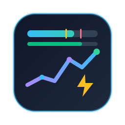
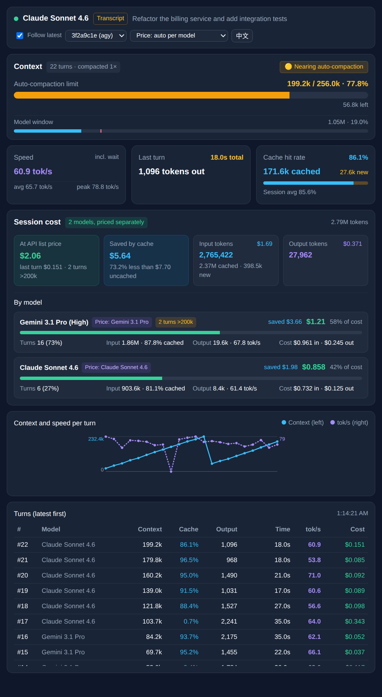

<div align="center">
  
  <h1>agy-pulse</h1>
  <p><strong>Context window, prompt cache, cost, and latency for Google Antigravity, in the side pane.</strong></p>
  <p>
    <a href="https://github.com/evenluo/agy-pulse/actions/workflows/ci.yml"></a>
    <a href="./LICENSE"></a>
    = 20" />
    
  </p>
  <p><a href="README_CN.md">中文文档</a></p>
</div>

agy-pulse is a native [Antigravity sidecar](#how-it-works) that shows, for the conversation you are in:

- **How close you are to auto-compaction.** Antigravity compacts context at about 256k tokens, well below the model's 1M window. Google does not document this threshold; it comes from [community measurements](https://github.com/google-antigravity/antigravity-cli/issues/878) on Gemini, and agy-pulse uses the host's value when the RPC reports one. agy-pulse shows both limits and, for models priced by prompt length, the 200k line above which long-context prices apply.
- **What the session would cost at API list prices**, per model, including long-context and dated price changes, and the amount prompt caching saved.
- **Where the time goes.** Time to first token (TTFT), end-to-end TPS, and pure decode TPS, with thinking tokens split from visible output.

It runs inside Antigravity's auxiliary pane, has no dependencies beyond Node.js, and reads only local data.

<p align="center"></p>

<sub>Screenshot rendered from the synthetic fixture in <code>test/fixtures/demo</code>.</sub>

## Install

Requires Node.js 20 or later on your `PATH`.

```bash
git clone https://github.com/evenluo/agy-pulse.git
node agy-pulse/install.mjs
```

This copies the sidecar to `~/.gemini/config/sidecars/context-monitor/`, sets `sidecars["context-monitor"].enabled = true` in `~/.gemini/config/config.json`, and configures the Antigravity CLI `statusLine` in `~/.gemini/antigravity-cli/settings.json` to run `statusline.mjs` (showing model, thinking effort, git branch, turn and compaction counts, context bar, prompt cache hit rate, session tokens/cost, and session average TPS). Other settings in those files stay as they are. If either file is not valid JSON, the installer stops and changes nothing.

Other ways to install:

| Mode | Command | Result |
| :--- | :--- | :--- |
| Plugin bundle (sidecar + agent skill) | `node agy-pulse/install.mjs --plugin` | Copies the repo to `~/.gemini/config/plugins/context-monitor/` and enables it. |
| Antigravity CLI | `agy plugin install https://github.com/evenluo/agy-pulse`, then `node ~/.gemini/config/plugins/<plugin-dir>/install.mjs` | The second command enables the sidecar and CLI `statusLine` of the installed plugin. |
| Per workspace | Copy the repo to `.agents/plugins/context-monitor/` in your project | Everyone who opens the workspace gets the plugin. |

Installer commands:

```bash
node install.mjs --status      # show what is installed and enabled
node install.mjs --uninstall   # disable in config.json / settings.json and remove installed files
node install.mjs --help
```

## Usage

1. Restart Antigravity (or open a new window) after the first install so it discovers the sidecar.
2. Open the auxiliary pane and select **Context & TPS**. You can also ask the agent to "open the Context & TPS monitor"; with the plugin bundle, the agent replies with a `[Context & TPS](sidecar://...)` link.
3. Use the header controls to follow the latest conversation or pick another one, to change the pricing profile, and to switch between English and Chinese.

## How it works

Antigravity starts `sidecars/context-monitor/server.mjs` from `sidecar.json`. The server listens on `127.0.0.1` and serves the panel and a JSON endpoint, `/api/metrics`. The panel polls that endpoint every 2 seconds while it is visible.

Metrics come from two sources:

| Source | When | Provides |
| :--- | :--- | :--- |
| Language Server RPC `GetCascadeTrajectoryGeneratorMetadata` | Antigravity injects `ANTIGRAVITY_LS_ADDRESS` and `ANTIGRAVITY_CSRF_TOKEN` | Millisecond TTFT and streaming duration, thinking vs. response tokens, cache write tokens, the host's compaction limit. Badge: **RPC**. |
| `~/.gemini/antigravity*/brain/<id>/.system_generated/logs/transcript.jsonl` | Always | Token usage per turn, model switches, `CHECKPOINT` (compaction) events. Durations are estimated from step timestamps. Badge: **Transcript**. |

When both are available, RPC values win and the transcript fills gaps.

### Metric definitions

| Metric | Definition |
| :--- | :--- |
| Context used | Input tokens of the latest turn (cached + uncached). |
| Auto-compaction limit | Context used ÷ compaction limit (RPC value, else 256,000). Green below 60%, amber to 85%, red above. The 200k tick marks where long-context prices start; it shows only when the current model has such a tier (Gemini 3.1 Pro, Gemini 2.5 Pro). |
| Model window | Context used ÷ 1,048,576 tokens, the model's full window. |
| Cache hit rate | Cached input ÷ total input, for the latest turn and for the session. |
| E2E TPS | Output tokens ÷ (TTFT + streaming time). This is the speed you perceive. |
| Decode TPS | Output tokens ÷ streaming time. Turns with less than 0.15 s of streaming are skipped as buffered. |
| Session averages | Total tokens ÷ total seconds over valid turns, so short turns do not skew the result. Interrupted turns (followed by `ERROR_MESSAGE`) are excluded. |
| Cost | Per turn, with that turn's model: uncached input, cached input, cache writes, and output at list price. For Gemini 3.1 Pro and 2.5 Pro, a turn whose input exceeds 200k uses the high tier. Gemini 4 Argon and Claude 4.6 or later have no such tier; Argon's price doubles for turns from 2026-12-01, and Gemini 3.6–3.8 Flash's from 2027-01-01. "Saved by cache" compares against all input billed as uncached. |

Prices live in [`sidecars/context-monitor/pricing.mjs`](sidecars/context-monitor/pricing.mjs). Model names map to a profile by family and version (for example `Claude Sonnet 5.5 (Thinking)`, `claude-opus-4-6`, `gemini-3.8-flash`). Unknown Claude versions use the Sonnet 4.6 or Opus 4.6–5 profile, unknown Flash versions use Gemini 2.5 Flash, and other names use Gemini 3.1 Pro. You can override the mapping from the pricing selector.

## Configuration

| Variable | Default | Purpose |
| :--- | :--- | :--- |
| `ANTIGRAVITY_SIDECAR_WEB_PORT` | `18990` | Port of the panel server. Antigravity sets it for the sidecar. |
| `AGY_GEMINI_ROOT` | `~/.gemini` | Where to look for transcripts. |
| `AGY_CONFIG_DIR` | `~/.gemini/config` | Target of the installer. `--config-dir <path>` does the same. |
| `AGY_CLI_SETTINGS_PATH` | `~/.gemini/antigravity-cli/settings.json` | Target CLI settings file for `statusLine`. `--cli-settings <path>` does the same. |

## Privacy and security

- The server binds to `127.0.0.1` only. It does not send data anywhere.
- The only outbound request is to the local Antigravity Language Server, with the CSRF token that Antigravity injects. The installer makes the same kind of request to apply the config change live.
- The panel shows the first 80 characters of the conversation's first prompt as its title. Any local process that can reach the port can read the same data from `/api/metrics`. The server answers only requests whose `Host` is `127.0.0.1`, `localhost`, or `[::1]`, so a web page cannot read it through DNS rebinding.
- The page loads no external scripts, styles, or fonts.

Report vulnerabilities privately; see [SECURITY.md](SECURITY.md).

## Limitations

- Costs are estimates at public list prices. They do not reflect your Antigravity plan, quotas, or negotiated rates, and they go stale when vendors change prices.
- Without RPC, TTFT and the thinking/response split are not available, and durations are estimated from transcript step timestamps.
- The transcript format and the RPC are Antigravity internals. A host update can change them.
- GPT-OSS 120B has no vendor list price and is billed as Gemini 3.1 Pro. Antigravity removes it on 2026-11-02.
- The 256k compaction default is measured on Gemini models. Without RPC data, non-Gemini models use the same default.
- CI covers Linux, macOS, and Windows. It runs the tests, not a live Antigravity host.

## Troubleshooting

| Symptom | Check |
| :--- | :--- |
| No **Context & TPS** tab | Run `node install.mjs --status`. Restart Antigravity after the first install. |
| Badge shows **Transcript** inside Antigravity | The Language Server did not answer. Metrics still work, with lower precision. |
| Panel is empty | No transcript exists yet under `~/.gemini/antigravity*/brain/`. Send a message first. |
| Panel shows `Forbidden host` | The request used a host name other than `127.0.0.1`, `localhost`, or `[::1]`. The sidecar log shows the rejected `Host`; please [open an issue](https://github.com/evenluo/agy-pulse/issues) with it. |
| Two panels appear | Standalone and plugin installs are both enabled. Rerun the installer in the mode you want; it disables the other entry. |

## Development

```bash
npm test                                         # node:test, no install step needed
AGY_GEMINI_ROOT=test/fixtures/demo npm start     # panel with demo data at http://127.0.0.1:18990
```

See [CONTRIBUTING.md](CONTRIBUTING.md) for the layout of the code and how to update prices.

## License

[MIT](LICENSE) © 2026 evenluo
