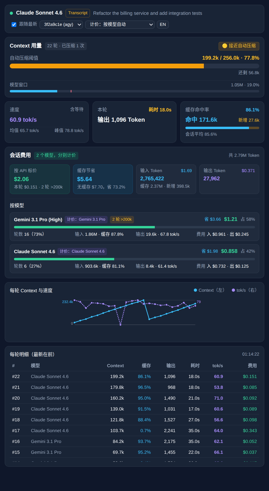

<div align="center">
  
  <h1>agy-pulse</h1>
  <p><strong>在 Google Antigravity 侧栏里查看 Context 窗口、Prompt Cache、费用和延迟。</strong></p>
  <p>
    <a href="https://github.com/evenluo/agy-pulse/actions/workflows/ci.yml"></a>
    <a href="./LICENSE"></a>
    = 20" />
    
  </p>
  <p><a href="README.md">English</a></p>
</div>

agy-pulse 是一个原生 [Antigravity Sidecar](#工作原理)。它针对当前对话显示三类信息：

- **离自动压缩还有多远。** Antigravity 在约 256k Token 时压缩上下文，远低于模型的 1M 窗口。agy-pulse 同时显示这两条线；对按提示词长度分档计价的模型，还显示开始按长上下文价格计费的 200k 线。
- **按 API 标价折算的会话费用。** 按模型分别计算，包含长上下文阶梯价和按日期生效的调价，并显示 Prompt Cache 节省的金额。
- **时间花在哪里。** 首字延迟（TTFT）、端到端 TPS 和纯解码 TPS，并把 Thinking Token 与可见输出分开。

它运行在 Antigravity 右侧辅助栏中，除 Node.js 外没有任何依赖，只读取本机数据。

<p align="center"></p>

<sub>截图由 <code>test/fixtures/demo</code> 中的合成数据渲染。</sub>

## 安装

需要 `PATH` 中有 Node.js 20 或更高版本。

```bash
git clone https://github.com/evenluo/agy-pulse.git
node agy-pulse/install.mjs
```

安装脚本把 Sidecar 复制到 `~/.gemini/config/sidecars/context-monitor/`，并在 `~/.gemini/config/config.json` 中设置 `sidecars["context-monitor"].enabled = true`。该文件中的其他设置保持不变。如果该文件不是合法 JSON，安装脚本停止运行，不修改任何文件。

其他安装方式：

| 方式 | 命令 | 结果 |
| :--- | :--- | :--- |
| 插件包（Sidecar + Agent Skill） | `node agy-pulse/install.mjs --plugin` | 把仓库复制到 `~/.gemini/config/plugins/context-monitor/` 并启用。 |
| Antigravity CLI | `agy plugin install https://github.com/evenluo/agy-pulse`，然后运行 `node ~/.gemini/config/plugins/<插件目录>/install.mjs` | 第二条命令启用已安装插件中的 Sidecar。 |
| 按工作区 | 把仓库复制到项目的 `.agents/plugins/context-monitor/` | 打开该工作区的所有成员都会加载插件。 |

安装脚本命令：

```bash
node install.mjs --status      # 查看安装和启用状态
node install.mjs --uninstall   # 在 config.json 中关闭并删除已安装文件
node install.mjs --help
```

## 使用

1. 首次安装后重启 Antigravity（或打开新窗口），使其发现 Sidecar。
2. 打开辅助栏，选择 **Context & TPS**。也可以让 Agent “打开 Context & TPS 监控面板”；安装插件包后，Agent 会回复一个 `[Context & TPS](sidecar://...)` 链接。
3. 用顶部控件跟随最新对话或选择其他对话、切换计价方案、切换中英文。

## 工作原理

Antigravity 按 `sidecar.json` 启动 `sidecars/context-monitor/server.mjs`。服务只监听 `127.0.0.1`，提供面板页面和 JSON 接口 `/api/metrics`。面板可见时每 2 秒轮询一次该接口。

指标来自两个数据源：

| 数据源 | 条件 | 提供 |
| :--- | :--- | :--- |
| Language Server RPC `GetCascadeTrajectoryGeneratorMetadata` | Antigravity 注入 `ANTIGRAVITY_LS_ADDRESS` 和 `ANTIGRAVITY_CSRF_TOKEN` | 毫秒级 TTFT 和流式耗时、Thinking 与正文 Token、缓存写入 Token、宿主的压缩阈值。徽标显示 **RPC**。 |
| `~/.gemini/antigravity*/brain/<id>/.system_generated/logs/transcript.jsonl` | 始终可用 | 每轮 Token 用量、模型切换、`CHECKPOINT`（压缩）事件。耗时由步骤时间戳估算。徽标显示 **Transcript**。 |

两个数据源都可用时，以 RPC 为准，Transcript 补充缺失字段。

### 指标定义

| 指标 | 定义 |
| :--- | :--- |
| Context 占用 | 最新一轮的输入 Token（缓存 + 未缓存）。 |
| 自动压缩阈值 | Context 占用 ÷ 压缩阈值（优先用 RPC 值，否则 256,000）。低于 60% 为绿色，60%–85% 为黄色，高于 85% 为红色。200k 刻度标记长上下文计价的起点，只在当前模型有该阶梯时显示（Gemini 3.1 Pro、Gemini 2.5 Pro）。 |
| 模型窗口 | Context 占用 ÷ 1,048,576 Token，即模型的完整窗口。 |
| 缓存命中率 | 缓存输入 ÷ 总输入，分最新一轮和整个会话。 |
| E2E TPS | 输出 Token ÷（TTFT + 流式耗时），即体感速度。 |
| Decode TPS | 输出 Token ÷ 流式耗时。流式耗时低于 0.15 秒的轮次视为整包缓冲，不参与计算。 |
| 会话均值 | 有效轮次的总 Token ÷ 总秒数，避免短轮次拉偏结果。中断轮次（后接 `ERROR_MESSAGE`）不参与计算。 |
| 费用 | 按每轮实际模型，分别以标价计算未缓存输入、缓存输入、缓存写入和输出。Gemini 3.1 Pro 和 2.5 Pro 单轮输入超过 200k 时使用高阶梯价。Gemini 4 Argon 和 Claude 4.6 及以后的模型没有该阶梯；Argon 从 2026-12-01 起的轮次按翻倍后的价格计算。“缓存节省”与全部输入按未缓存计价的结果比较。 |

价格表位于 [`sidecars/context-monitor/pricing.mjs`](sidecars/context-monitor/pricing.mjs)。模型名按关键字映射到价格方案（`opus`、`sonnet`/`claude`、`flash`、`argon`/`gemini 4`、`2.5`，其余按 Gemini 3.1 Pro）。可以在计价下拉框中手动指定。

## 配置

| 变量 | 默认值 | 用途 |
| :--- | :--- | :--- |
| `ANTIGRAVITY_SIDECAR_WEB_PORT` | `18990` | 面板服务端口。Antigravity 为 Sidecar 设置该值。 |
| `AGY_GEMINI_ROOT` | `~/.gemini` | Transcript 查找目录。 |
| `AGY_CONFIG_DIR` | `~/.gemini/config` | 安装目标目录。`--config-dir <path>` 作用相同。 |

## 隐私与安全

- 服务只绑定 `127.0.0.1`，不向外发送数据。
- 唯一的出站请求发往本机 Antigravity Language Server，使用 Antigravity 注入的 CSRF Token。安装脚本发送同类请求，使配置立即生效。
- 面板把对话首条提示的前 80 个字符作为标题。能访问该端口的本机进程可以从 `/api/metrics` 读取相同数据。服务只响应 `Host` 为 `127.0.0.1`、`localhost` 或 `[::1]` 的请求，因此网页无法通过 DNS rebinding 读取这些数据。
- 页面不加载任何外部脚本、样式或字体。

请通过 [GitHub Security Advisories](https://github.com/evenluo/agy-pulse/security/advisories/new) 私下报告漏洞。

## 限制

- 费用是按公开标价的估算，不反映你的 Antigravity 套餐、配额或协议价，厂商调价后会过时。
- 没有 RPC 时，TTFT 和 Thinking/正文拆分不可用，耗时由 Transcript 步骤时间戳估算。
- Transcript 格式和 RPC 属于 Antigravity 内部实现，宿主更新可能改变它们。
- CI 覆盖 Linux 和 macOS，未在 Windows 上测试。

## 排障

| 现象 | 检查 |
| :--- | :--- |
| 没有 **Context & TPS** 标签 | 运行 `node install.mjs --status`。首次安装后重启 Antigravity。 |
| 在 Antigravity 内徽标显示 **Transcript** | Language Server 没有响应。指标仍可用，精度较低。 |
| 面板为空 | `~/.gemini/antigravity*/brain/` 下还没有 Transcript。先发送一条消息。 |
| 面板显示 `Forbidden host` | 请求使用了 `127.0.0.1`、`localhost`、`[::1]` 以外的主机名。Sidecar 日志会记录被拒绝的 `Host`，请附上该值[提交 Issue](https://github.com/evenluo/agy-pulse/issues)。 |
| 出现两个面板 | 独立安装和插件安装同时启用。按需要的方式重新运行安装脚本，它会关闭另一项。 |

## 开发

```bash
npm test                                         # node:test，无需安装依赖
AGY_GEMINI_ROOT=test/fixtures/demo npm start     # 用示例数据启动面板：http://127.0.0.1:18990
```

代码结构和价格更新方法见 [CONTRIBUTING.md](CONTRIBUTING.md)。

## 许可证

[MIT](LICENSE) © 2026 evenluo
